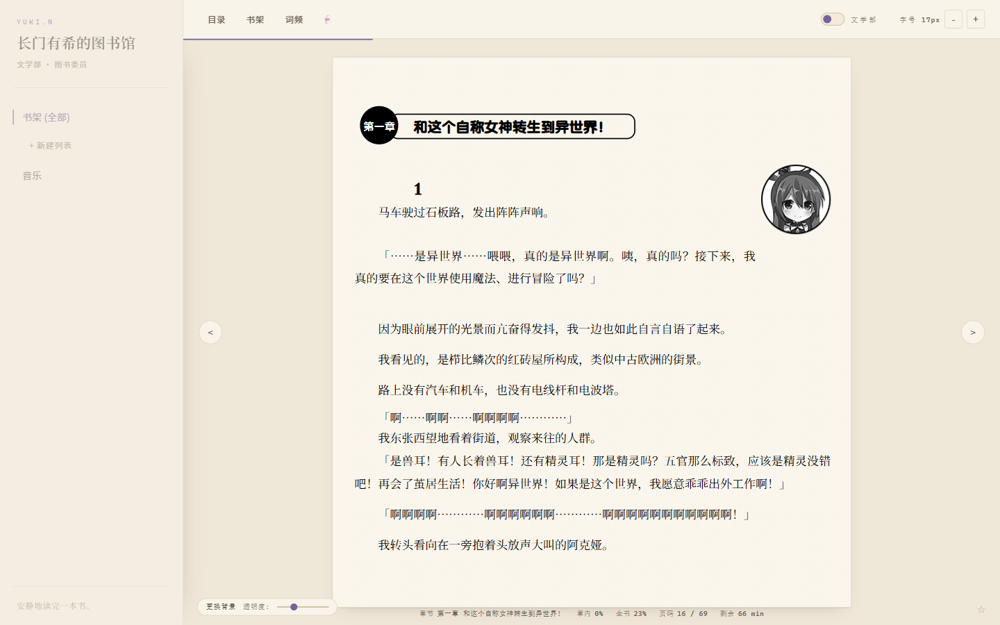

# Yuki 的图书馆

浏览器里的 ePub 阅读器：把 `.epub` 拖进网页，就能在书架里管理、按章节阅读。
纯 HTML + CSS + 原生 JavaScript，**没有构建步骤、没有后端、没有 npm 依赖**，书和进度都存在本机
IndexedDB 里，断网也能读。

最初是 2025 年的期末答辩项目，2026 年做了一轮完整重构与修补（见下方「v2 更新」），
又把视觉按「长门有希」重做了一遍（见「v3 视觉」）。

## 两副面孔

同一个书架，两种形态，用开关切换（会记住）：

- **文学部 · 浅色**：纸色底、衬线正文、2em 首行缩进、紫藤色点缀——像社团教室窗边的读书角。
- **统合思念体 · 夜间**：近黑底、荧光绿、界面用等宽字体、扫描线、右下角 HUD——长门有希的终端形态。
  正文仍然是衬线，荧光绿只给界面，不拿长文阅读体验换气氛。

| 文学部 | 统合思念体 |
| --- | --- |
|  |  |
|  |  |


## 快速开始

```bash
# 方式一：仓库自带的零依赖服务器（需要 Node.js 18+）
npm start          # 然后打开 http://127.0.0.1:5173

# 方式二：任意静态服务器都可以，例如
npx serve .
python -m http.server 5173
```

> 必须通过 `http://` 打开，不要双击 `index.html`：Service Worker / IndexedDB 在 `file://` 下不可用，
> 而且阅读器的图片、样式需要经过 Service Worker 从 ePub 里解包。

## 功能

- **书架**：拖拽或点「+」导入 ePub，自动读封面/书名，支持搜索书名、自定义列表分类、删除、清空。
- **阅读进度**：记住每本书读到哪一页（CFI），书架卡片显示进度条和「已读 x% · 继续阅读」，重开自动续读。
- **目录**：多级目录、按标题筛选、当前章节高亮；在目录里按回车可以对**全书正文**搜索，结果带关键词高亮，点击直接跳转。
- **排版**：字号加减（持久保存）、日间/夜间主题（持久保存）、自定义背景图与透明度。
- **信息面板**：章节名、章节内进度、全书进度、页码、剩余阅读时间。
- **词频分析**：一键统计当前章节的高频词（彩蛋功能）。
- **快捷键 / 命令面板**：`Ctrl+K` 打开命令面板，可直接搜书名跳转。
- **音乐**：侧边栏「音乐」可导入本地音频当背景音（列表存在 IndexedDB）。
- **离线**：Service Worker 接手 ePub 内部资源请求，epub.js 与 JSZip 都内置在仓库里，不再依赖 CDN；页面加载后即使断网也能继续读书。
- **响应式**：窄屏下侧边栏变成抽屉，阅读区、工具栏自适应。

### 快捷键

| 按键 | 作用 |
| --- | --- |
| `←` / `→`、`A` / `D` | 上一页 / 下一页 |
| `空格` / `PageDown` / `PageUp` | 下一页 / 上一页 |
| 滚轮 | 翻页 |
| `Esc` | 关闭目录 / 侧边栏 |
| `Ctrl+K`（macOS 为 `⌘K`） | 命令面板 |

## 数据存在哪里

- 书（ePub 文件、封面、进度、目录 locations）、列表、音乐、设置 → 浏览器 **IndexedDB**（库名 `yuki_library_db`）。
- 主题、字号 → `localStorage`（键 `yuki:theme`、`yuki:fontSize`）。
- 换浏览器 / 清缓存 = 数据丢失，这是纯前端应用的取舍；换设备请重新导入书。

## 目录结构

```
index.html          单页入口（书架 + 阅读器两套视图）
style.css           全部样式（日/夜主题变量 + 响应式）
js/main.js          启动、主题、设置、快捷键绑定
js/bookshelf.js     书架：导入、列表、进度展示、删除
js/reader.js        阅读器：渲染、目录、全书搜索、信息面板、词频
js/db.js            IndexedDB 封装
js/app.js           视图切换与全局事件
js/music.js         音乐播放器
js/command-palette.js  命令面板
js/ui.js            Toast / 正则转义 / 节流等工具
js/dom.js, events.js, utils.js, icon.js   DOM 引用、事件名、占位封面、图标
sw.js               Service Worker：把 ePub 内部资源映射成 HTTP 响应
vendor/epub.min.js  epub.js 0.3.88（本地内置，不依赖 CDN）
jszip.min.js        JSZip（Service Worker 解包 ePub 用）
serve.mjs           零依赖本地静态服务器
```

## v2 更新（2026）

**修复**

- 浅色主题下阅读信息面板被整块 `display:none` 隐藏 → 现在两种主题都显示（浅色为白卡片样式）。
- 主题选择每次刷新都被强制重置为日间 → 主题现在持久保存，并在首帧前恢复，没有闪白。
- 字号不保存、重开回到 16px → 字号持久保存并应用到书内正文。
- 「IN-CHAPTER」章节内进度永远显示 `--%` → 改为按目录/章节在页码表中的区间计算，跳章后续读也准确。
- 目录面板 `z-index` 压住阅读工具栏，导致「返回书架 / 词频」点不到 → 目录移入阅读区内部，只覆盖正文。
- 文件选择器接受 `.pdf` 却打不开，点开是空白阅读器且无提示 → 只收 ePub，导入/打开非 ePub 时给出明确提示。
- 全书搜索用未转义的用户输入构造 `RegExp`，输入 `(` 等字符会报错 → 已转义，并限制最多渲染 200 条结果。
- 深色主题给正文套等宽字体，中文被拉出奇怪字距 → 只换颜色，正文字体保持可读。
- 侧边栏标题在夜间主题下换行 → 缩小字号并禁止拆词。

**新增**

- 书架进度条 + 「已读 x% · 继续阅读」，最近在读的书排最前。
- Toast 通知替代 `alert()`（导入结果、错误、彩蛋）。
- 非阻塞的快捷键（空格 / PageUp / PageDown / Esc），输入框聚焦时不误翻页。
- 移动端：侧边栏抽屉 + 遮罩、阅读区与工具栏自适应、窄屏信息面板下沉。
- 命令面板支持导入后即时注册新书（同 id 覆盖，不再重复）。
- `npm start` 一条命令起服务；GitHub Pages 自动部署 workflow；README 重写。
- 目录面板内的搜索结果计数、空目录提示。

## v3 视觉（2026）

把原来「蓝色后台 + 外来日夜组件」的混搭，收成一套围绕角色的设计语言：

- 设计变量重写：纸色/墨色/紫藤（浅色）与近黑/荧光绿（夜间），间距、圆角、阴影统一。
- 书架：封面加书脊阴影、悬停抬起；标题省列号；导入卡写明「导入 ePub」；进度条与「已读 23% · 继续阅读」。
- 阅读页：正文衬线 + 2em 首行缩进 + 1.9 行距，页边留白 30/34；只作用于真正的正文段落（`p` 文本 ≥ 20 字），
  书籍自带的章节号、图注等装饰不被覆盖。
- 顶部阅读进度条；信息条白天是页脚一行，夜间是右下角 HUD。
- 换掉外来的「云朵日夜」开关，改成两态模式开关（阅读工具栏 + 侧边栏底部各一个），标签随模式变「文学部 / 统合」，
  侧边栏身份文案也从「文学部 · 图书委员」切换成「资讯统合思念体 · 终端 No.7」。
- 目录：章节序号、当前章高亮、窄屏覆盖正文但不压工具栏。
- 弹窗 / Toast / 命令面板 / 音乐面板全部按两套主题重绘。
- 系统日志面板默认收起隐藏（想调试可以在 `style.css` 里删掉 `#log-console { display:none }`）。

## 部署到线上

仓库自带 `.github/workflows/pages.yml`：推到 `main` 后，到仓库 **Settings → Pages → Build and deployment**
选择 **GitHub Actions**，之后每次推送都会发布到 `https://<用户名>.github.io/yuki-s-library/`。

也可以直接丢到 Netlify / Vercel / Cloudflare Pages，构建命令留空、发布目录填仓库根目录即可。

## 致谢

- 参考设计：[pacexy/flow](https://github.com/pacexy/flow)（开源 ePub 阅读器）
- ePub 解析：[epub.js](https://github.com/futurepress/epub.js)
- Courier Prime 字体：SIL Open Font License 1.1（Google Fonts / @fontsource）

## License

MIT
